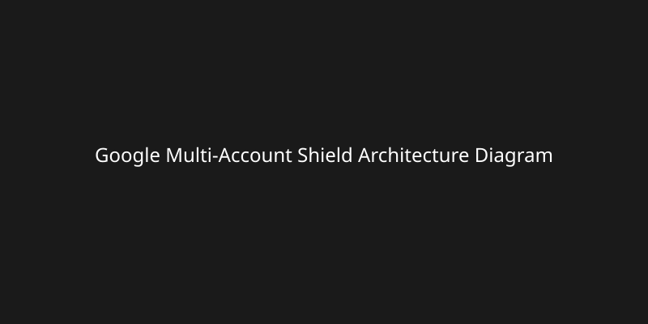

  
  <h1>Google Multi-Account Shield & Unlimited Account Vault</h1>

  
  
  
  
  
  

## ⚡ BIG 1-CLICK DOWNLOAD SECTION (For Non-Technical Users / Beginners)

If you just want to install the extension and stop accidental "Sign out of all accounts" forever, follow these easy steps!

### [📥 Download Ready-to-Use Extension (.ZIP) — Click Here](https://github.com/tawhid4x/google-multi-account-shield/releases/latest/download/google-multi-account-shield-extension.zip)

### Step-by-Step Beginner Installation Guide (3 Simple Steps)
1. Click the Download button above and Extract (Unzip) the downloaded file on your computer.
2. Open Google Chrome, type `chrome://extensions` in the address bar, press Enter, and turn ON "Developer mode" in the top-right corner.
3. Click "Load unpacked" in the top-left corner and select the extracted folder. Done! Everything now works automatically in the background!

🇧🇩 <b>বাংলায় ইনস্টল করার সবচেয়ে সহজ নিয়ম (এখানে ক্লিক করুন)</b>

### ৩টি সহজ ধাপে ইনস্টল করুন:
১. উপরের "Download" বাটনে ক্লিক করে ফাইলটি ডাউনলোড করুন এবং আপনার কম্পিউটারে Unzip/Extract করুন।
২. গুগল ক্রোম (Google Chrome) ওপেন করে অ্যাড্রেস বারে `chrome://extensions` লিখে Enter চাপুন। ডানদিকের উপরের কোণায় "Developer mode" চালু করুন।
৩. বামদিকের উপরের কোণায় "Load unpacked" এ ক্লিক করুন এবং আপনার Unzip করা ফোল্ডারটি সিলেক্ট করুন। ব্যাস! এখন থেকে আপনার সব অ্যাকাউন্ট সুরক্ষিত থাকবে।

## 🎯 The Problem vs. Our Solution

| Standard Chrome 🔴 | Google Multi-Account Shield 🟢 |
| :--- | :--- |
| Accidental "Sign out of all accounts" button right under "+ Add another account" | "Sign out of all accounts" safely hidden |
| 10-account limit (authuser=9) | 100-200+ accounts |
| Constant "Signed out" errors | Instant 1-click hot-swap |
| Complex extension popup hassle | Zero popup hassle, scrollable natively |

## ✨ Key Features & Architecture Deep-Dive (For Senior Engineers)

### 1. Zero-Flash Multi-Frame MutationObserver & CSS Sign-Out Shield
Hides the native "Sign out" buttons natively in Chrome at `document_start` inside all frames to prevent sudden, destructive sign-outs.

### 2. Non-Destructive Background Cookie Vault & Overflow Eviction Engine
Intelligently swaps `chrome.cookies` in and out of local `chrome.storage.local` memory to bypass Google's 10-account overflow limit, retaining active states natively.

### 3. Native Google Account Menu DOM Injector
With seamless real-time search functionality directly within the native Google menu and smooth scrolling for over 200 accounts.

## 🔒 100% Privacy & Security Guarantee
This extension runs purely offline on your machine.
- Zero external servers.
- Zero tracking or analytics.
- Zero network requests to third parties.
- All session tokens remain securely on your `chrome.storage.local`.

## 🔍 SEO Keywords & FAQ Section

**Why do my Gmail accounts keep signing out automatically in Chrome when I add more than 8 accounts?**
Google Chrome limits parallel logged-in sessions natively to about 10 (`authuser=0` to `9`). This extension rotates active cookie sessions to effectively raise this limit infinitely.

**How do I hide the "Sign out of all accounts" button in Gmail/Google?**
By using this extension, it dynamically hides the element directly within the native Google iframe without disabling "+ Add another account".

**How to get the Sign out button back if I actually want to sign out?**
Simply disable the extension from the `chrome://extensions` page or turn off Shield mode in the extension popup.
